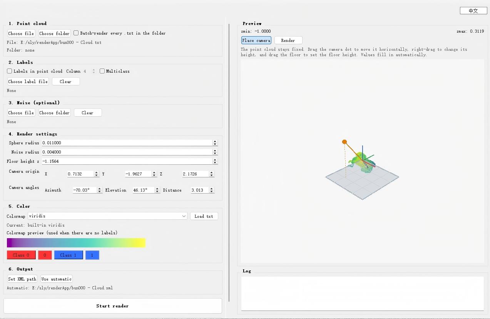

# Mitsuba Point Cloud Renderer

A lightweight GUI tool for point cloud visualization and rendering, built on Mitsuba. Available in Chinese and English.

<p align="center">
  
</p>

## Features

- **Single-file and batch rendering** — Render one point cloud or an entire folder, with automatic Mitsuba XML generation.
- **Interactive scene setup** — Manually place the camera and floor to automatically generate their coordinates.
- **Flexible coloring** — Visualize binary or multiclass labels, configure class colors, and use built-in or custom colormaps with adjustable color ranges.
- **Rendering controls** — Adjust point size, noise-point size, and vertical offset; cancel rendering while it is in progress.
- **Noise overlay** — Add a noise point cloud, with automatic filename matching in batch mode.
- **Preview and logs** — View rendered results, open existing TIFF files, and track rendering progress in the log panel.
- **GPU / CPU support** — Use CUDA on supported NVIDIA GPUs, with CPU fallback.
- **Standalone Windows app** — Run the packaged executable without installing Python or project dependencies.

## Requirements

- Windows 64-bit
- Python 3.8+ for development
- Dependencies: `mitsuba`, `drjit`, `numpy`, `matplotlib`, `imageio`, `OpenEXR`, `PyQt5`

## Run

Create a Python environment and install the required dependencies:

```bash
conda create -n mitsuba_renderer python=3.10
conda activate mitsuba_renderer
pip install -r requirements.txt
```

Then run the application:

```bash
python mistuba_tool.py
```

## Build EXE

Install PyInstaller:

```bash
pip install pyinstaller
```

Build the Windows executable:

```bash
pyinstaller --clean --noconfirm mistuba_tool.spec
```

The packaged executable will be generated at:

```text
dist/mistuba_tool.exe
```

End users can run the prebuilt executable directly without installing Python or the development environment.

## Input Format

Point cloud `.txt` file:

```text
x y z
```

Or with labels:

```text
x y z label
```

Label and noise settings:

- The label column is configurable; the 4th column is used by default.
- Binary mode supports up to 2 distinct label values, such as `0/1`.
- Enable **Multiclass labels** for more than 2 classes.
- In batch noise mode, noise filenames must match the clean point cloud filenames, for example `clean/a.txt` ↔ `noise/a.txt`.

## Notes

- The first launch of the packaged EXE may be slower because PyInstaller extracts temporary files at startup.

## Acknowledgements

Built with [Mitsuba Renderer](https://www.mitsuba-renderer.org/). Thanks to the Mitsuba team for providing the rendering framework.
